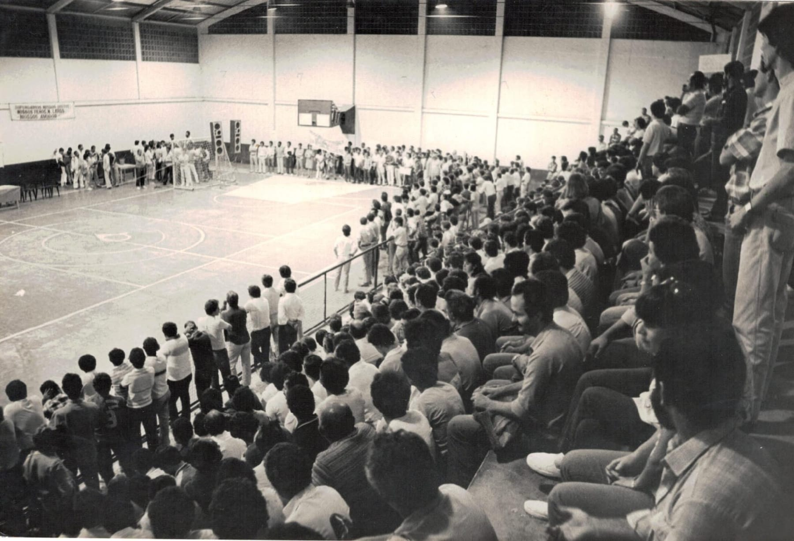
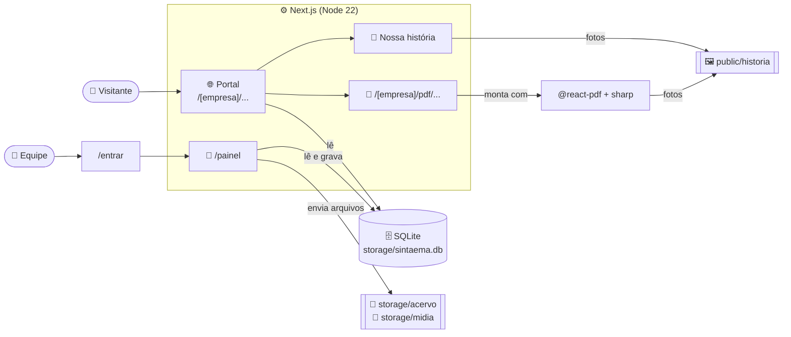
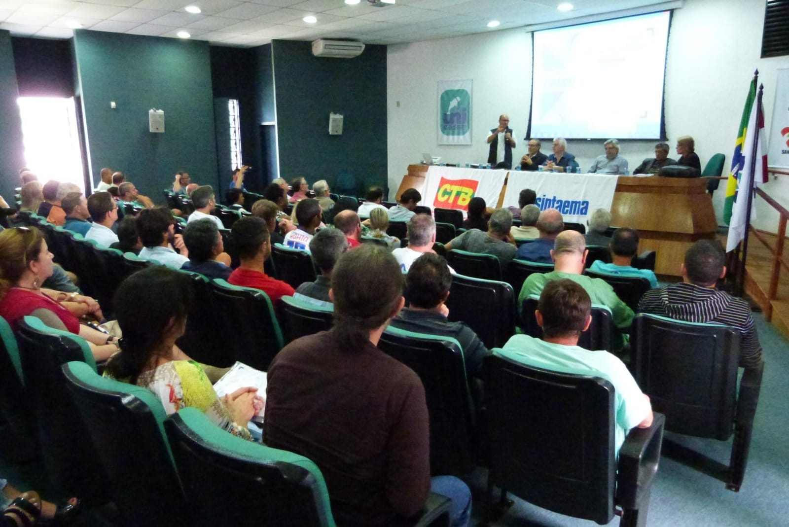

<div align="center">


# SINTAEMA-SC

### Portal do Sindicato dos Trabalhadores em Água, Esgoto e Meio Ambiente de Santa Catarina

**_“Água é vida, privatizá-la é crime.”_**

[](https://nextjs.org)
[](https://react.dev)
[](https://www.typescriptlang.org)
[](https://tailwindcss.com)
[](https://nodejs.org)
[](https://nodejs.org/api/sqlite.html)
[](https://sintaema.vercel.app)

[**🌐 Ver o site**](https://sintaema.vercel.app) · [**📜 Nossa história**](https://sintaema.vercel.app/casan/historia) · [**🔐 Área restrita**](https://sintaema.vercel.app/entrar)

<br />



<sub>📷 <i>1985: Assembleia estadual. Acervo SINTAEMA.</i></sub>

</div>

<br />

> [!NOTE]
> Desde **9 de novembro de 1977** o SINTAEMA-SC organiza trabalhadoras e trabalhadores do saneamento catarinense. Este repositório é o portal da entidade: notícias, lutas, jurídico, filiação, agenda, a experiência interativa **“Nossa história”**, documentos em PDF e um **painel interno** para a diretoria, a comunicação e o acervo do sindicato.

---

## 📑 Sumário

- [✨ Destaques](#-destaques)
- [📜 Nossa história, uma experiência de storytelling](#-nossa-história-uma-experiência-de-storytelling)
- [🏢 Portal por empresa](#-portal-por-empresa)
- [📄 Documentos em PDF](#-documentos-em-pdf)
- [🔐 Painel interno e perfis de acesso](#-painel-interno-e-perfis-de-acesso)
- [🧱 Arquitetura](#-arquitetura)
- [🗂️ Estrutura de pastas](#️-estrutura-de-pastas)
- [🚀 Como rodar no seu computador](#-como-rodar-no-seu-computador)
- [⚙️ Variáveis de ambiente](#️-variáveis-de-ambiente)
- [☁️ Publicação na Vercel](#️-publicação-na-vercel)
- [✏️ Guia de manutenção](#️-guia-de-manutenção)
- [♿ Acessibilidade e desempenho](#-acessibilidade-e-desempenho)
- [🩺 Problemas comuns](#-problemas-comuns)

---

## ✨ Destaques

<table>
<tr>
<td width="50%" valign="top">

### 🌊 Portal institucional
Página inicial, notícias com categorias, campanhas, eleições, jurídico, agenda, filiação, contato e busca (<kbd>Ctrl</kbd> + <kbd>K</kbd>). Animações de água em todo o site: bolhas, cáusticas, gotas e o percurso **“do manancial à sua torneira”**.

</td>
<td width="50%" valign="top">

### 📜 Nossa história
Uma narrativa em 9 capítulos que se revela com a rolagem: a página sai do preto e branco da ditadura e **ganha cor** até chegar à água pública. Inclui um **acervo com 25 fotos reais** (1985–2017).

</td>
</tr>
<tr>
<td valign="top">

### 🏢 Um portal para cada empresa
CASAN, BRK, Tubarão, Itapoá, Hydrobrasil, Serrana EBS e AEGEA têm o próprio endereço, cores e logo, com conteúdo filtrado para cada base.

</td>
<td valign="top">

### 📄 PDFs editoriais
Matérias, caderno de notícias, agenda, perfil institucional, jurídico, filiação e o **dossiê histórico**, gerados na hora, prontos para imprimir.

</td>
</tr>
<tr>
<td valign="top">

### 🔐 Painel com três perfis
Administração de usuários, editor de notícias com upload de imagens, agenda, informativos e um **acervo de documentos** pesquisável.

</td>
<td valign="top">

### 🪶 Leve de propósito
Sem bibliotecas de animação e sem banco externo: o motor de rolagem é próprio e o banco é o **SQLite embutido no Node 22**.

</td>
</tr>
</table>

---

## 📜 Nossa história, uma experiência de storytelling

> Rota: **`/[empresa]/historia`**. O item **“O Sindicato”** do menu abre esta página, e o endereço antigo `/[empresa]/sobre` redireciona para ela.

A história do sindicato é contada como uma narrativa visual. Cada movimento tem função narrativa: a cor volta à página conforme a democracia volta ao país, a água sobe e cobre a tela quando a luta passa a ser pela água pública, e a lista de 500 demissões é riscada pela própria rolagem.

| # | Capítulo | O que acontece na tela |
|:-:|---|---|
| **00** | **Abertura** | Título palavra a palavra sobre a assembleia de 1985; a imagem se aproxima e surge o contador de anos de história. |
| **01** | **Anos de chumbo** | A imagem fica fixa enquanto os parágrafos passam; a palavra-chave troca a cada trecho. |
| **02** | **Onde tudo começou** | **1975** → a data **09 / 11 / 1977** se monta vinda de três direções → as fotos da fundação se revelam. |
| **03** | **As primeiras batalhas** | A rolagem vira um percurso **horizontal** pelas greves de 1985–1988 até o clímax de **1989**: 36 dias de greve e 5 de greve de fome. |
| **04** | **Conquistas e transformações** | Lista interativa de direitos → **a água sobe e cobre a tela (2002)** → o número **500** é riscado. |
| **05** | **Pessoas que fizeram a história** | Uma **impressão digital se desenha** enquanto fotos da categoria chegam em profundidades diferentes. |
| **06** | **O Sindicato ao longo do tempo** | Linha do tempo com 12 marcos (clique, setas do teclado, anterior/próximo) + **Acervo** com filtro por década e visualizador em tela cheia. |
| **07** | **O presente e o futuro** | Compromissos, faixa de atuação em movimento, números animados e o 1º Congresso. |
| **∞** | **Uma história que continua** | “A vida segue e a luta continua” acende palavra por palavra; download do **dossiê em PDF** e texto original na íntegra. |

<details>
<summary><b>🎞️ Como as animações funcionam (por dentro)</b></summary>

<br />

- **Motor próprio, sem dependências** ([`motion.tsx`](src/components/historia/motion.tsx)): um único listener de scroll + `requestAnimationFrame` calcula o progresso de cada cena e grava **variáveis CSS** (`--p`, `--p0`, `--p1`…) no elemento. Toda a animação acontece em CSS, só com `transform`, `opacity` e `clip-path`, e **sem re-render do React** durante a rolagem.
- **Cenas fora da tela são ignoradas** (`IntersectionObserver`).
- **Primitivas:** `Scene` (cena fixada com fases), `Parallax`, `SplitReveal` (títulos palavra a palavra), `FadeIn` e `ScrollText` (texto que acende com a rolagem).
- **Paleta fixa da entidade:** a história usa sempre as cores do SINTAEMA, independente do tema da empresa.
- **Movimento reduzido:** com `prefers-reduced-motion`, as cenas deixam de fixar e mostram o estado final.

</details>

<details>
<summary><b>📷 Fotos da história: como adicionar ou trocar</b></summary>

<br />

Cada espaço de foto tem uma **finalidade narrativa** e um nome de arquivo. Basta salvar a foto em `public/historia/` com o nome indicado (`.jpg`, `.jpeg`, `.png` ou `.webp`) e ela aparece no lugar certo, **na página e no PDF**, sem mexer no código. Enquanto o arquivo não existe, a página mostra a placa **“Foto do acervo a inserir”** dizendo qual imagem vai ali.

- Lista completa dos espaços: [`public/historia/LEIA-ME.md`](public/historia/LEIA-ME.md)
- Textos, legendas e lista do acervo: [`src/data/historia.ts`](src/data/historia.ts)
- As fotos atuais vêm da apresentação **“SINTAEMA: 40 anos de sonhos, lutas e conquistas” (2017)**, com as legendas originais.

**Ainda faltam** (não há fotos dessas épocas na apresentação): anos 1970, Associação de 1975, fundação de 1977, primeira diretoria, fundadores, diretoria atual, 1º Congresso e sede.

</details>

---

## 🏢 Portal por empresa

O endereço raiz (`/`) mostra a escolha da empresa. Cada empresa tem o próprio portal em **`/[empresa]`**, com cores e logo próprios. As cores claras e escuras são calculadas automaticamente a partir de três cores-base ([`src/lib/theme.ts`](src/lib/theme.ts)).

| Empresa | Endereço |
|---|---|
| CASAN | `/casan` |
| BRK Ambiental Blumenau | `/brk-blumenau` |
| BRK Ambiental Caçador | `/brk-cacador` |
| Tubarão Saneamento | `/tubarao` |
| Itapoá Saneamento | `/itapoa` |
| Hydrobrasil | `/hydrobrasil` |
| Serrana EBS | `/serrana-ebs` |
| AEGEA | `/aegea` |

**Páginas de cada portal:** início · `historia` · `noticias` (+ categorias Notícias, Lutas, Eleições, Jurídico, Agenda) · `noticias/[slug]` · `juridico` · `filie-se` · `agenda` · `contato` · `busca` · `pdf/...`

> [!TIP]
> Matérias, eventos e informativos podem valer para **todas** as empresas ou só para algumas (campo `companies`). Os endereços antigos sem empresa (`/sobre`, `/noticias`…) levam à tela de escolha.

---

## 📄 Documentos em PDF

Gerados sob demanda com [`@react-pdf/renderer`](https://react-pdf.org) e `sharp` (fotos ajustadas para impressão, em sépia ou preto e branco conforme a época). Rota: **`/[empresa]/pdf/<documento>`**.

| Documento | Endereço | Observação |
|---|---|---|
| 📰 Matéria | `pdf/noticias/<slug>` | Uma notícia formatada |
| 🗞️ Caderno de notícias | `pdf/noticias` | `?categoria=Lutas` filtra por categoria |
| 📅 Agenda | `pdf/agenda` | Próximos eventos |
| 🏛️ Perfil institucional | `pdf/sobre` | Identidade, valores e trajetória |
| ⚖️ Jurídico | `pdf/juridico` | Assessoria jurídica |
| ✊ Filiação | `pdf/filie-se` | Como se filiar |
| 📜 **Dossiê histórico** | `pdf/historia` | A história completa com as fotos do acervo |

- `?download=1` força o download; sem ele, o PDF abre no navegador.
- Exemplos prontos em [`exemplos-pdf/`](exemplos-pdf).

---

## 🔐 Painel interno e perfis de acesso

Entrada em **`/entrar`** (link “Área restrita” no topo do site). Login só com e-mail e senha.

| Perfil | Tela inicial | Administração | Conteúdo | Acervo |
|---|---|:-:|:-:|:-:|
| 🛡️ **Administrador** | `/painel/admin` | ✅ | ✅ | ✅ |
| ✍️ **Jornalista** | `/painel/conteudo` | — | ✅ | ✅ |
| 🗂️ **Diretor** | `/painel/acervo` | — | — | ✅ |

<details>
<summary><b>🛡️ Administração</b></summary>

<br />

Visão geral (usuários ativos, matérias publicadas, rascunhos, documentos no acervo), cadastro e exclusão de usuários e atalhos para as tarefas mais comuns.

</details>

<details>
<summary><b>✍️ Conteúdo</b></summary>

<br />

- **Notícias:** criar, editar, publicar ou mover para rascunho, excluir; categoria, destaque, empresas e **upload de imagem** (até 12 MB).
- **Agenda** e **informativos**.
- As imagens enviadas ficam em `storage/midia/` e são servidas por `/midia/<arquivo>`.

</details>

<details>
<summary><b>🗂️ Acervo de documentos</b></summary>

<br />

Arquivo digital do sindicato, com pesquisa por texto e filtros por **tipo**, **empresa** e **período**.

Tipos: Bomba d’Água · Boletim / Informativo · Ata de assembleia · Ata de reunião · Acordo coletivo (ACT) · Ofício · Processo jurídico · Relatório / Prestação de contas · Estatuto / Regimento · Foto · Outro.

Formatos aceitos: imagens, PDF, Word, Excel, PowerPoint, OpenDocument e texto.

</details>

<details>
<summary><b>🔒 Segurança</b></summary>

<br />

- Senhas com **scrypt**; no banco fica só o hash.
- Sessões de **7 dias** em cookie `httpOnly`; o banco guarda apenas o hash do token.
- **Bloqueio de 5 minutos** após 5 tentativas erradas de login.
- Senha com no mínimo 8 caracteres, letras e números.
- A conta de administrador vem das variáveis de ambiente (veja abaixo).

</details>

---

## 🧱 Arquitetura



| Camada | Tecnologia |
|---|---|
| Framework | **Next.js 15** (App Router, Server Components, Server Actions, Turbopack em desenvolvimento) |
| Interface | **React 19**, **Tailwind CSS 3**, fontes Oswald, Source Sans 3 e Source Serif 4 |
| Temas | Variáveis CSS `--c-*` geradas por empresa, consumidas pelas cores `brand-*` do Tailwind |
| Dados | **`node:sqlite`** (SQLite embutido no Node 22), sem ORM e sem serviço externo |
| PDFs | **@react-pdf/renderer** + **sharp** |
| Animações | CSS + motor próprio de rolagem (sem GSAP ou Framer Motion) |
| Hospedagem | **Vercel** |

---

## 🗂️ Estrutura de pastas

```text
sindicato/
├── 📁 public/
│   ├── empresas/            → logos das empresas
│   ├── historia/            → fotos da história (+ LEIA-ME.md com os nomes)
│   │   └── acervo/          → 25 fotos do acervo (1985–2017)
│   └── images/              → imagens das notícias iniciais
├── 📁 src/
│   ├── app/
│   │   ├── page.tsx                → escolha da empresa
│   │   ├── [empresa]/              → portal de cada empresa
│   │   │   ├── historia/           → experiência “Nossa história” (+ historia.css)
│   │   │   ├── noticias/ juridico/ filie-se/ agenda/ contato/ busca/
│   │   │   ├── sobre/              → redireciona para /historia
│   │   │   └── pdf/[...doc]/       → geração de PDFs
│   │   ├── entrar/                 → login
│   │   ├── painel/                 → admin · conteudo · acervo
│   │   └── midia/[name]/           → imagens enviadas pelo painel
│   ├── components/
│   │   ├── historia/               → capítulos, motor de animação, acervo
│   │   ├── painel/                 → interface do painel
│   │   └── water/                  → efeitos de água
│   ├── data/                       → empresas, textos institucionais, história
│   ├── lib/                        → tema por empresa, formatação
│   ├── pdf/                        → documentos em PDF
│   └── server/                     → banco, autenticação, arquivos, notícias, acervo
├── 📁 scripts/criar-admin.mjs      → gera as variáveis do administrador
├── 📁 exemplos-pdf/                → PDFs de exemplo
└── 📁 storage/                     → banco e arquivos enviados (fora do git)
```

---

## 🚀 Como rodar no seu computador

> [!IMPORTANT]
> É preciso **Node.js 22**: o banco usa o módulo `node:sqlite`, que vem embutido nessa versão.

**1. Instale as dependências**

```bash
npm install
```

**2. Crie a conta de administrador** (pergunta nome, e-mail e senha e grava em `.env.local`)

```bash
npm run criar-admin
```

**3. Inicie o servidor de desenvolvimento**

```bash
npm run dev
```

Abra **http://localhost:3000**, escolha uma empresa e explore. O painel fica em **http://localhost:3000/entrar**.

| Comando | O que faz |
|---|---|
| `npm run dev` | Servidor de desenvolvimento (Turbopack) |
| `npm run build` | Build de produção |
| `npm run start` | Roda o build de produção |
| `npm run lint` | Verifica o código com ESLint |
| `npm run criar-admin` | Gera as variáveis da conta de administrador |

> [!TIP]
> Na primeira execução o banco é criado em `storage/sintaema.db` com notícias, eventos e informativos iniciais.

---

## ⚙️ Variáveis de ambiente

| Variável | Obrigatória | Para que serve |
|---|:-:|---|
| `SINTAEMA_ADMIN_EMAIL` | ✅ | E-mail da conta de administrador |
| `SINTAEMA_ADMIN_PASSWORD_HASH` | ✅ | Hash **scrypt** da senha (formato `scrypt$...`), gerado por `npm run criar-admin` |
| `SINTAEMA_ADMIN_NAME` | — | Nome exibido do administrador (padrão: “Administrador”) |
| `SINTAEMA_DATA_DIR` | — | Pasta do banco e dos arquivos (padrão: `storage/`; na Vercel, `/tmp/sintaema`) |

A conta de administrador só é criada se o e-mail ainda não existir; contas já cadastradas não são alteradas. **A senha nunca é gravada**, só o hash.

---

## ☁️ Publicação na Vercel

1. Importe o repositório na Vercel (Node **22.x**, já definido em `package.json`).
2. Rode `npm run criar-admin` no seu computador e cole as três linhas em **Settings → Environment Variables**.
3. Faça o deploy. Cada `git push` publica uma nova versão.

> [!WARNING]
> **Na Vercel a pasta do projeto é somente leitura** e o banco fica em `/tmp`, que é **temporário**: quando o servidor reinicia, notícias criadas pelo painel, usuários e documentos enviados ao acervo **voltam ao conteúdo inicial**. Para guardar dados de verdade em produção, use um servidor com disco persistente (definindo `SINTAEMA_DATA_DIR`) ou migre o armazenamento para um banco e um storage externos.

---

## ✏️ Guia de manutenção

<details>
<summary><b>🖼️ Adicionar uma foto à história</b></summary>

<br />

Salve o arquivo em `public/historia/` com o nome do espaço (veja [`LEIA-ME.md`](public/historia/LEIA-ME.md)). Para a legenda, preencha `caption` no espaço correspondente em [`src/data/historia.ts`](src/data/historia.ts). Para a galeria do acervo, coloque o arquivo em `public/historia/acervo/` e acrescente uma linha na lista `archive`.

</details>

<details>
<summary><b>🏢 Adicionar uma nova empresa</b></summary>

<br />

1. Coloque o logo em `public/empresas/`.
2. Acrescente a empresa em [`src/data/companies.ts`](src/data/companies.ts) com `slug`, nome e as três cores-base (`primary`, `accent`, `secondary`).
3. Pronto: o portal `/<slug>` passa a existir com tema próprio.

</details>

<details>
<summary><b>📝 Mudar textos institucionais</b></summary>

<br />

- História e números: [`src/data/historia.ts`](src/data/historia.ts) (inclui o texto original na íntegra)
- Perfil, jurídico e filiação (site e PDF usam o mesmo texto): [`src/data/institucional.ts`](src/data/institucional.ts)
- Contatos, slogan e redes sociais: [`src/data/site.ts`](src/data/site.ts)

</details>

<details>
<summary><b>📰 Publicar notícias</b></summary>

<br />

Pelo painel, em **Conteúdo → Notícias → Nova notícia**. As notícias iniciais ficam em [`src/server/seed.ts`](src/server/seed.ts) e só são gravadas no banco na primeira execução.

</details>

---

## ♿ Acessibilidade e desempenho

- ✅ Respeita **`prefers-reduced-motion`** em todo o site.
- ✅ Navegação por teclado na linha do tempo, no acervo (setas e <kbd>Esc</kbd>) e no sumário de capítulos.
- ✅ Títulos animados mantêm o texto completo para leitores de tela.
- ✅ Imagens otimizadas com `next/image` e fotos do acervo comprimidas.
- ✅ Animações só com `transform`, `opacity` e `clip-path`, sem re-render durante a rolagem.
- ✅ Layout pensado para celular: carrossel de deslizar, sumário em pílula e cenas adaptadas.

---

## 🩺 Problemas comuns

<details>
<summary><b>Erro 500 com <code>ENOENT ... .next/...manifest</code> no desenvolvimento</b></summary>

<br />

O cache `.next` foi corrompido. Acontece quando a pasta está no **OneDrive** (a sincronização trava os arquivos temporários) ou quando um `next build` roda ao mesmo tempo que o `next dev`. Pare o servidor, apague a pasta `.next` e rode `npm run dev` de novo. Para evitar, mantenha o projeto fora de pastas sincronizadas.

</details>

<details>
<summary><b><code>node:sqlite</code> não encontrado</b></summary>

<br />

Você está usando uma versão do Node anterior à 22. Instale o Node 22 e rode `npm install` novamente.

</details>

<details>
<summary><b>Não consigo entrar no painel</b></summary>

<br />

Confira se `SINTAEMA_ADMIN_EMAIL` e `SINTAEMA_ADMIN_PASSWORD_HASH` estão definidos (em `.env.local` ou na Vercel) e reinicie o servidor. Depois de 5 tentativas erradas, o login fica bloqueado por 5 minutos.

</details>

---

<div align="center">



<sub>📷 <i>2017: Atividade dos 40 anos do SINTAEMA na Grande Florianópolis. Acervo SINTAEMA.</i></sub>

<br /><br />

### A vida segue e a luta continua. ✊

**SINTAEMA-SC** · Florianópolis, SC · (48) 3224-3868 · secretaria@sintaema.org.br

<sub>Fundado em 9 de novembro de 1977.</sub>

</div>
